# Installing Debian 12 on VxBuild

## Creating a Debian 12 USB Install Drive <a href="#create-debian-12-usb" id="create-debian-12-usb"></a>

To install Debian 12 on the build machine (VxBuild), download the latest Debian 12 amd64 installer file from the [latest Debian release](https://www.debian.org/releases/stable/debian-installer/).

Use a blank USB drive to create the install drive. The process described below erases any existing content.

To create a USB install drive with the downloaded ISO file:

1. Ensure that the USB drive is available to the system. It typically attaches as the `/dev/sda` device. To verify this, run the following command:

```
lsblk /dev/disk/by-id/usb*part* --noheadings --output PATH
```

2. If the USB drive is not attached as the `/dev/sda` device, replace `/dev/sda` in the next command with the device that the USB drive attached to.

* NOTE: The command below must not include any number as part of the device path. For example, if the above command returns `/dev/sda1`, you must use `/dev/sda` as the path in the next command.

3. To create the USB install drive, run the following command:

```
dd if=/path/to/debian-12.8.0-amd64-netinst.iso of=/dev/sda bs=4M && sync
```

* NOTE: At the time of writing, the latest stable release is 12.8. If using a newer version, update the file name accordingly.

4. When the command completes, remove the USB install drive from the system.

## Installing Debian 12 on VxBuild <a href="#installing-to-vxbuild" id="installing-to-vxbuild"></a>

1. Before powering VxBuild on, insert the USB install drive created in the previous step.
2. After powering VxBuild on, begin pressing F12 until it enters the boot menu. Boot the system from the USB install drive.
3. The following screen appears. Select "Graphical install" and press enter.

<figure>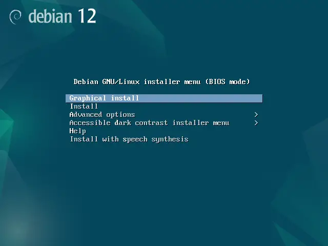<figcaption></figcaption></figure>

4. Select your preferred language and click "Continue".

<figure>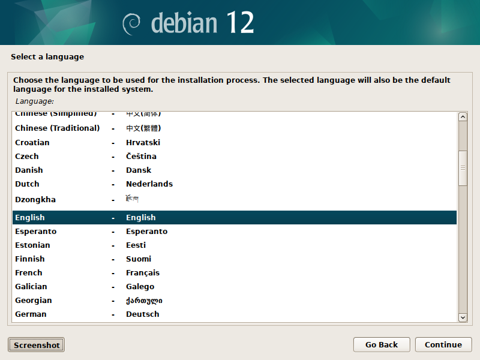<figcaption></figcaption></figure>

5. Select your location and click "Continue".

<figure>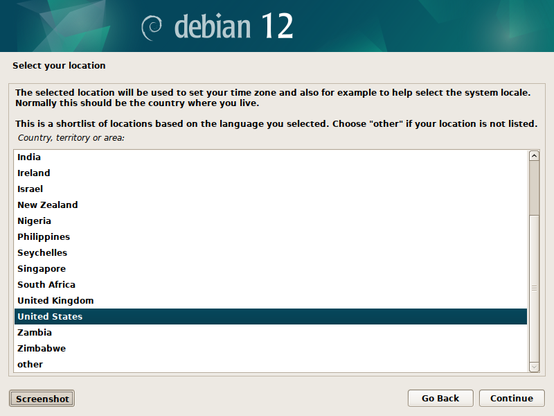<figcaption></figcaption></figure>

6. Select your keyboard layout and click "Continue".

<figure>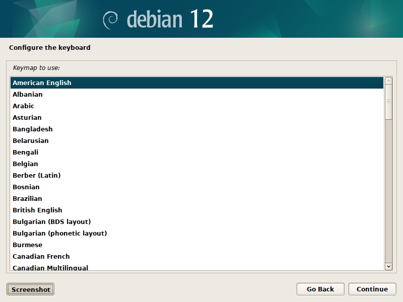<figcaption></figcaption></figure>

7. Select your network device (it may differ from the screenshot) and click "Continue".

<figure>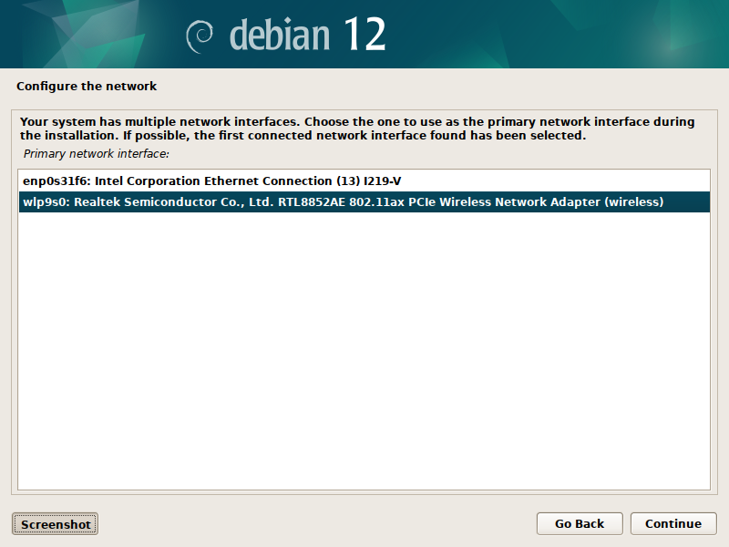<figcaption></figcaption></figure>

8. If using a wired connection, the network configures automatically.
9. If using a wireless connection, select a network, select WPA/WPA2 PSK, and click "Continue". Enter your wireless network password and click "Continue".

<figure>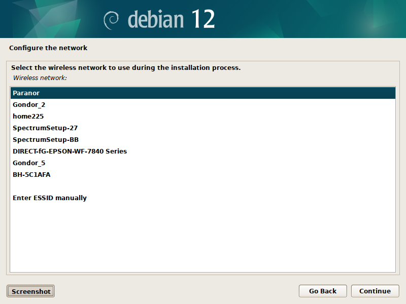<figcaption></figcaption></figure>

<figure>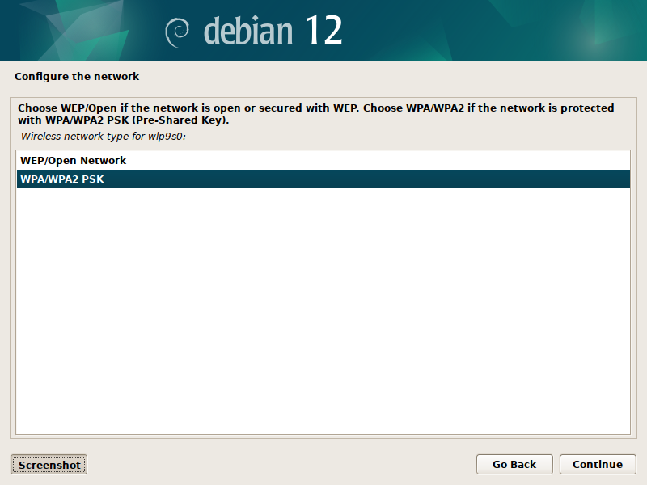<figcaption></figcaption></figure>

<figure>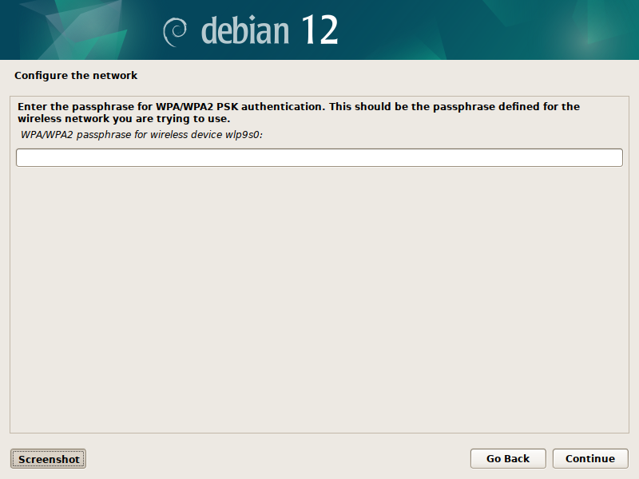<figcaption></figcaption></figure>

10. Enter "VxBuild" for the hostname and click "Continue".

<figure>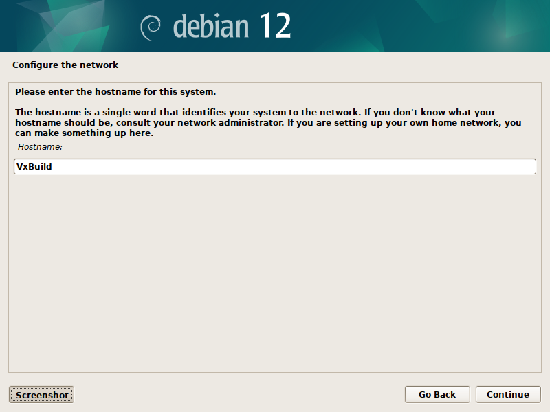<figcaption></figcaption></figure>

11. Leave the domain name blank and click "Continue".

<figure>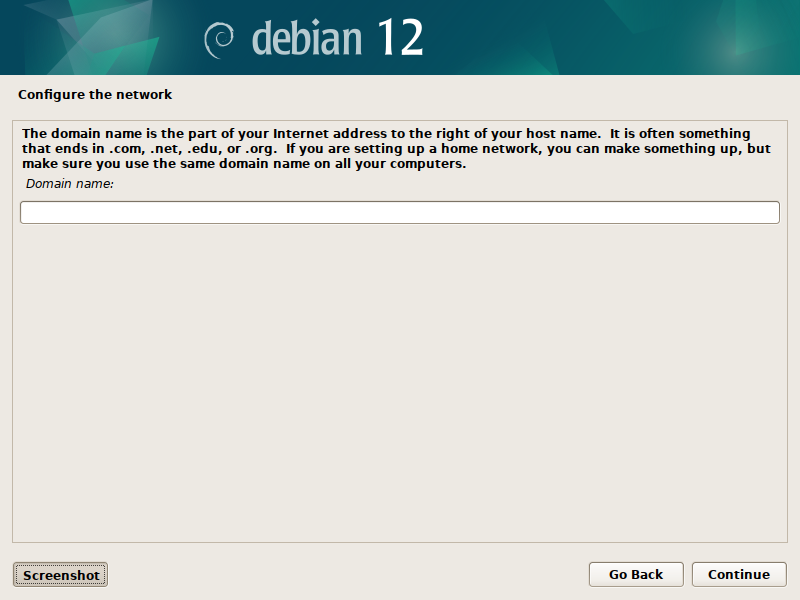<figcaption></figcaption></figure>

12. Set the root user password and click "Continue".

<figure>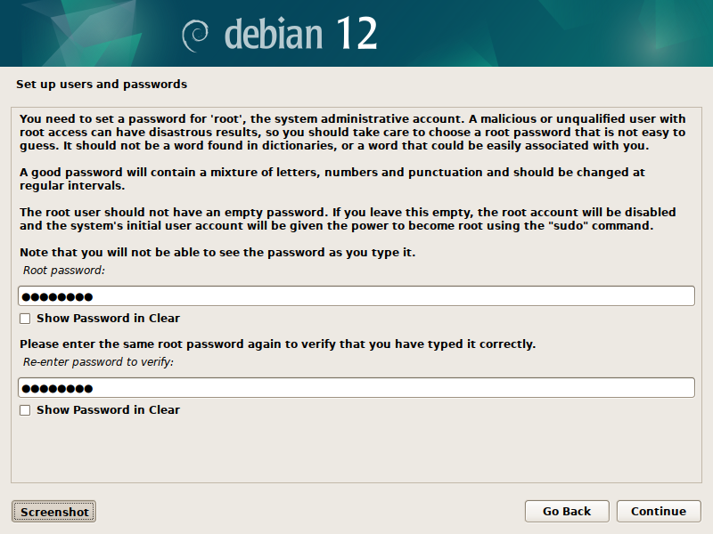<figcaption></figcaption></figure>

13. Enter "Vx" for the full name for the new user and click "Continue".

<figure>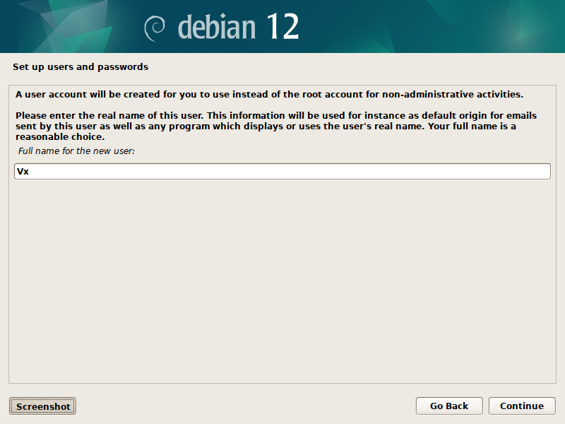<figcaption></figcaption></figure>

14. Enter "vx" as the username and click "Continue".

<figure>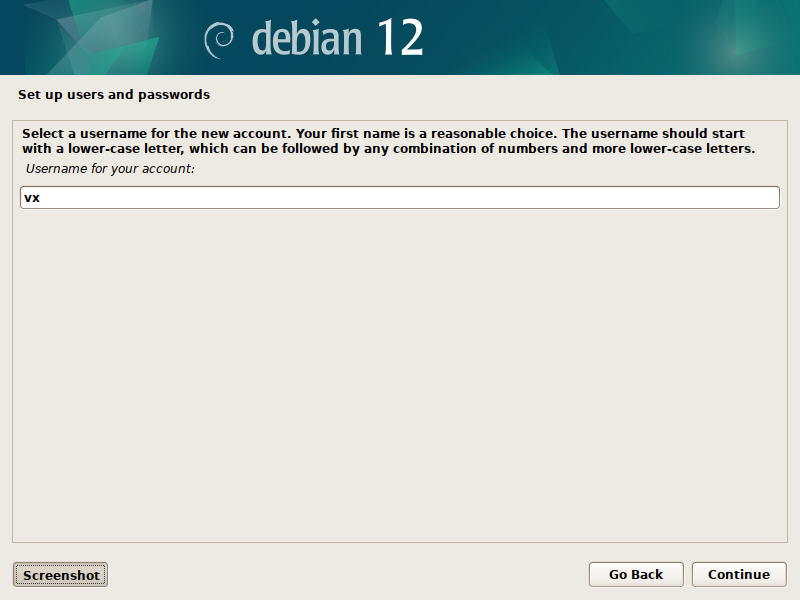<figcaption></figcaption></figure>

15. Enter a password for the "vx" user and click Continue.

<figure>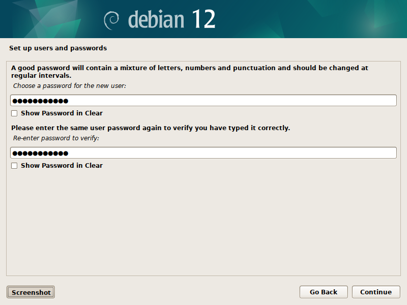<figcaption></figcaption></figure>

16. Select your timezone and click "Continue".

<figure>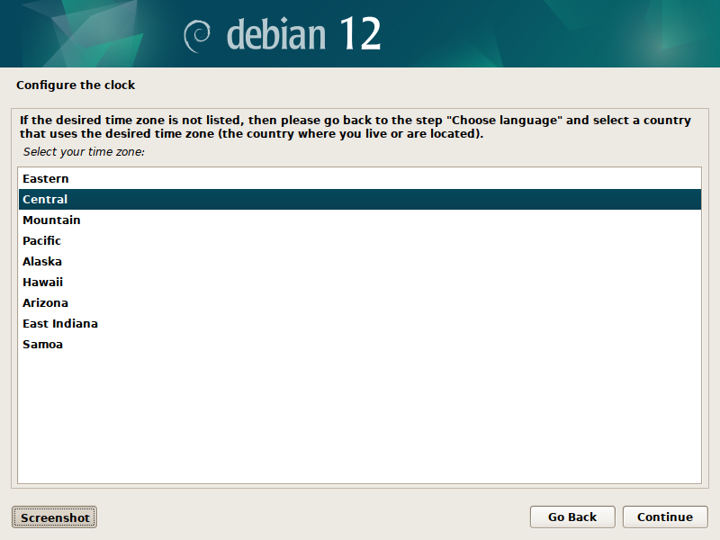<figcaption></figcaption></figure>

17. Select "Guided - use entire disk" and click "Continue".

<figure>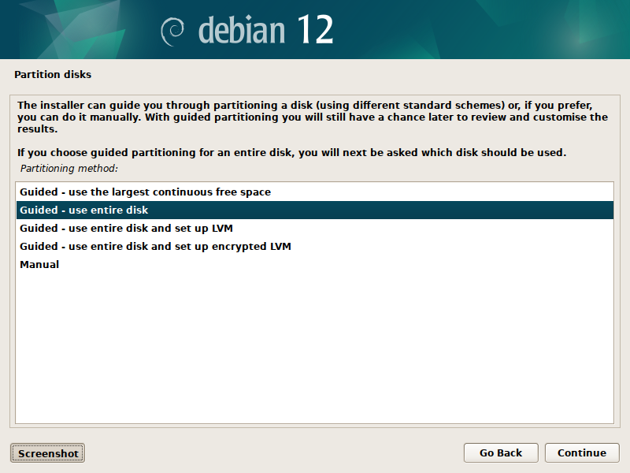<figcaption></figcaption></figure>

18. Select the "/dev/nvme0n1" disk and click "Continue".

<figure>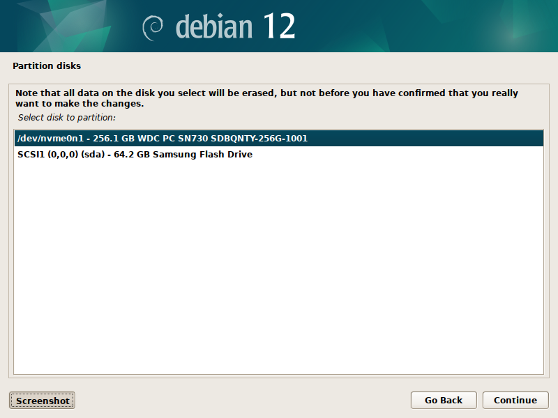<figcaption></figcaption></figure>

19. Select "All files in one partition" and click "Continue".

<figure>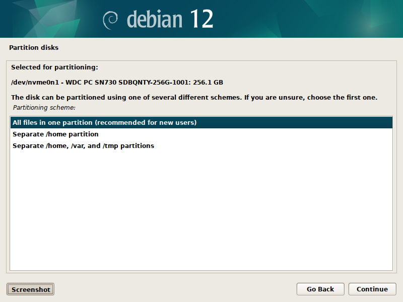<figcaption></figcaption></figure>

20. Select "Finish partitioning and write changes to disk" and click "Continue".

<figure>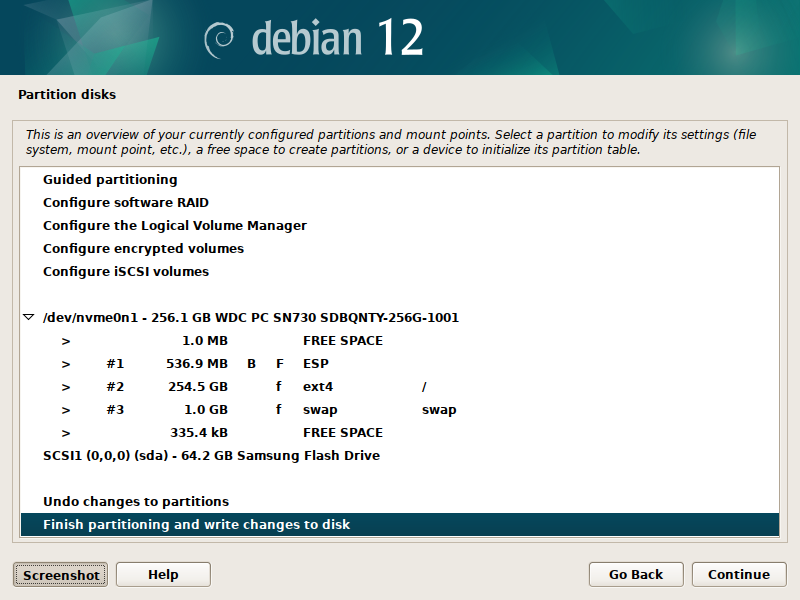<figcaption></figcaption></figure>

21. Select "Yes" and click "Continue".

<figure>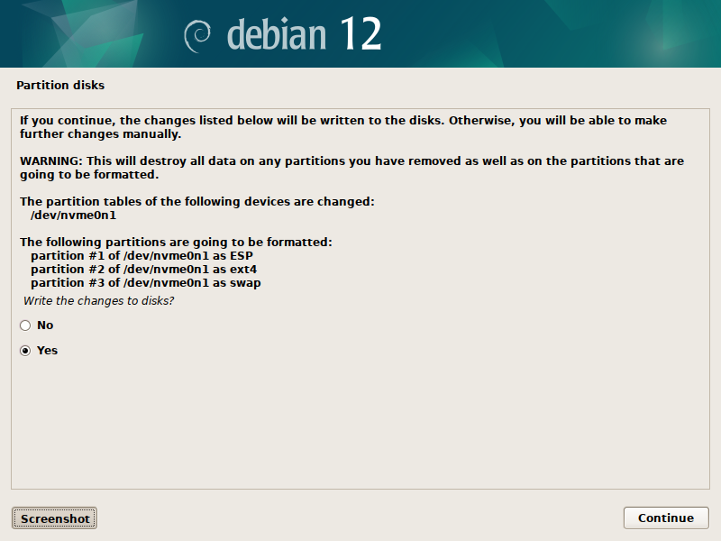<figcaption></figcaption></figure>

22. The base operating system installation begins. During the installation, the installer asks questions related to package management.
23. Select "United States" and click "Continue".
24. Select "deb.debian.org" and click "Continue".
25. Leave the proxy information blank and click "Continue".
26. When asked to configure "popularity-contest", select "No" and click "Continue".
27. The installation process continues. When it completes, a final screen confirms that it was successful.
28. Remove the USB drive and click "Continue".
29. The system reboots and automatically starts Debian 12.
30. Log in with the "vx" user and password you created during the installation process.
31. Several basic configuration prompts are displayed. Select "Next".
32. Select your keyboard preference and click "Next".
33. Turn off Location Services and click "Next".
34. Do not configure any online accounts. Select "Skip".
35. Click the "Start Using Debian GNU/Linux" button. The dialog closes.

## **Grant Sudo Privileges**

The "vx" user needs to be granted sudo privileges related to configuring and initializing the build environment tools.

1. Open a terminal window.
2. As the "vx" user, temporarily log in to the "root" account:

```
su -
<Enter root user password>
```

3. The terminal window prompt changes to `root@VxBuild`. To grant the "vx" user sudo privileges, run the following commands as root:

```
echo "vx ALL=NOPASSWD: ALL" > /etc/sudoers.d/vx
exit
```

4. The terminal window prompt changes to `vx@VxBuild`, showing that the session is again the "vx" user instead of the "root" user. To confirm sudo privileges, run the following command:

```
sudo whoami
```

The command returns "root", which confirms that sudo privileges have been granted correctly.
