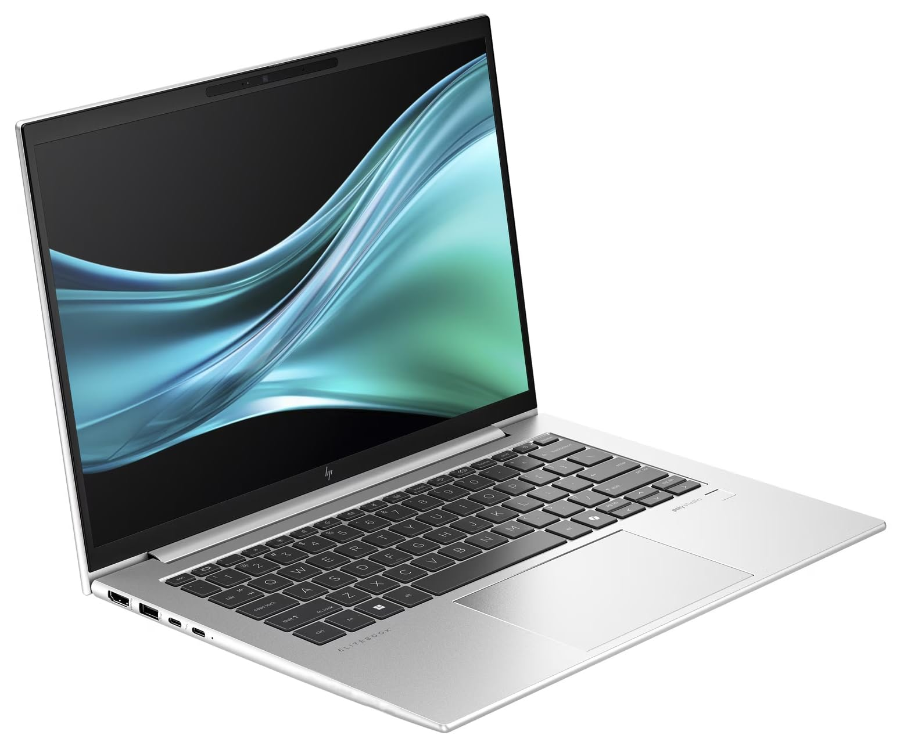
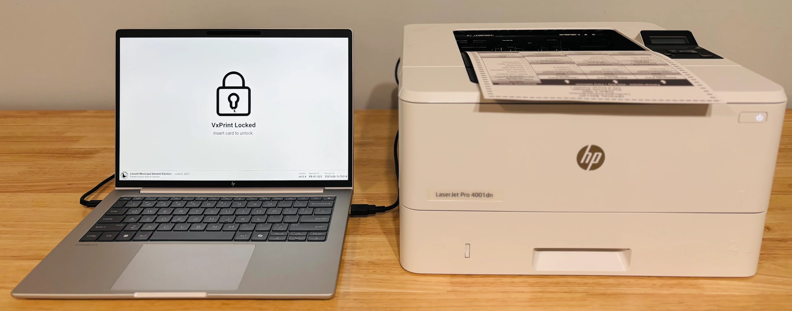
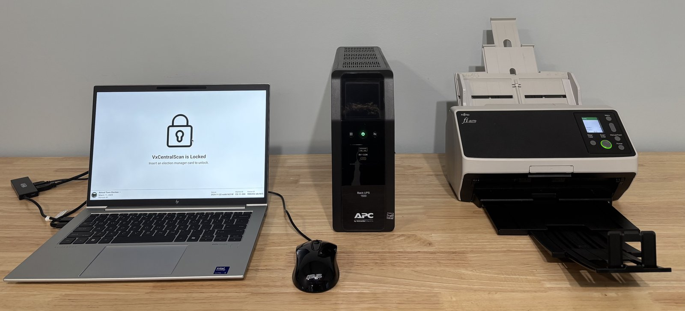

# VxAdmin, VxPrint, & VxCentralScan Hardware

## Overview

### Laptop 

VxAdmin, VxPrint, and VxCentralScan are laptops which connect to peripherals as needed. The laptop is a [custom configured HP Elitebook 840 14" G11](vxadmin-and-vxcentralscan-hardware.md#laptop-specification).

<figure><figcaption>
Laptop keyboard and screen
</figcaption></figure> <figure><figcaption>
Laptop ports
</figcaption></figure>

The relevant hardware interfaces are:

* **Smart Card Reader:** Enables reading and writing to smart cards, which is the basis for authentication in VxSuite
* **USB Ports:** Allows connecting to the peripherals for scanning or printing
* **HDMI Port:** Allows connecting the laptop to an external display, which is most often used to enlarge the adjudication interfaces when adjudication is performed by a group of people

While not strictly necessary, VxAdmin, VxPrint, and VxCentralScan are bundled with a mouse and a USB hub for ease of use. A USB A-B cable is included to connect to the peripherals.

### VxAdmin

VxAdmin connects to a printer for the purposes of printing reports. The printer includes an RJ45 (Ethernet) port which is blocked by a port blocker because network connectivity is not required by the printer.

The VxAdmin printer is powered through an APC BN1500M2 uninterruptible power supply (UPS) to ensure that the printer can operate in variable power environments.

<figure><figcaption>
VxAdmin fully connected with mouse, hub, charger, USB cable, and printer
</figcaption></figure>

### VxPrint

VxPrint connects to either the HP LaserJet Pro 4001dn printer or, for jurisdictions with color requirements on their ballots, the HP Color LaserJet Pro 4201dn printer. Both printers are duplex. The 4001dn prints black and white at up to 40 pages per minute. The 4201dn prints bubble ballots in color at up to 35 pages per minute.

The included printer tray of either printer can be extended from letter size to legal size. VotingWorks, in partnership with HP, can provide a tray extender that allows printing up to 22 in. ballots.

Each printer has an Ethernet port which is not used for operation of VxPrint, so it is blocked by an RJ45 port blocker.

The VxPrint printer is powered through an APC BN1500M2 UPS to ensure that the printer can operate in variable power environments.

<figure><figcaption>
VxPrint laptop connected to ballot printer
</figcaption></figure>

### VxCentralScan

VxCentralScan connects to a batch scanner for batch scanning. The scanner is either the small Ricoh fi-8170, the medium Ricoh fi-7600, the large Ricoh fi-8950, or the extra-large interScan DeskPro 631. Ballots are loaded into the hopper and then, after a scan is triggered from the application, the scanner processes the ballots one-by-one, sending images to the application for interpretation.

Each of the scanners can be used with an imprinter from its manufacturer (not pictured), which allows printing an identifier on each ballot as it exits the scanner, which can be useful for certain types of post-election audits.

The fi-8170, fi-8950, and DeskPro 631 each have an RJ45 (Ethernet) port which is blocked by a port blocker because network connectivity is not required by the scanner.

The batch scanner is powered through an APC BN1500M2 UPS to ensure that the scanner can operate in variable power environments.

<figure><figcaption>
VxCentralScan fully connected with mouse, hub, charger, USB cable, scanner (fi-8170), and power backup
</figcaption></figure>

## Bill of Materials

All components for VxAdmin, VxPrint, and VxCentralScan are commercial off-the-shelf (COTS) components. Data sheets and related documentation are available [in the documentation repository](https://github.com/votingworks/docs-vxsuite-v4/tree/main/hardware-assets/cots-documentation/central-system).

### Shared Components (Laptop & Accessories)

<table><thead><tr><th width="152">Manufacturer</th><th width="263">Component</th><th>Mfr. Part Number</th><th>Criticality</th></tr></thead><tbody><tr><td>HP</td><td>Elitebook 840 14" G11 Laptop</td><td>B43P6UP#ABA</td><td>High</td></tr><tr><td>Tripp Lite</td><td>4-Port Ultra-Slim USB Hub</td><td>U360-004-SLIM</td><td>Medium</td></tr><tr><td>Logitech</td><td>B100 Mouse</td><td>910-006061</td><td>Medium</td></tr><tr><td>Monoprice</td><td>USB-A to USB-B 2.0 6ft Cable</td><td>5438</td><td>Medium</td></tr></tbody></table>

### VxAdmin & VxPrint Components (Printer)

<table><thead><tr><th width="152">Manufacturer</th><th width="263">Component</th><th width="167.58465576171875">Mfr. Part Number</th><th>Criticality</th></tr></thead><tbody><tr><td>HP</td><td>LaserJet Pro 4001dn Printer</td><td>2Z600F#BGJ</td><td>Medium</td></tr><tr><td>HP</td><td>Color LaserJet Pro 4201dn Printer (VxPrint only)</td><td>4RA85F#BGJ</td><td>Medium</td></tr><tr><td>Lindy</td><td>RJ45 Port Blocker</td><td>40471</td><td>Low</td></tr><tr><td>APC</td><td>Uninterruptible Power Supply (UPS)</td><td>BN1500M2</td><td>Low</td></tr></tbody></table>

### VxAdmin Networking Components

These components are only relevant if the jurisdiction is using multiple VxAdmins networked together for multi-station adjudication.

<table><thead><tr><th width="152">Manufacturer</th><th width="264.83984375">Component</th><th width="167.58465576171875">Mfr. Part Number</th><th>Criticality</th></tr></thead><tbody><tr><td>Cisco</td><td>Catalyst 1200-8T-D Switch</td><td>1200-8T-D</td><td>Medium</td></tr><tr><td>Monoprice</td><td>Cat6 Ethernet Patch Cable, Various Lengths</td><td>Varies by length, e.g., 3ft is 9821</td><td>Low</td></tr><tr><td>Startech.com</td><td>USB-C to Ethernet Adapter</td><td>US1GC30B2</td><td>Low</td></tr></tbody></table>

### VxCentralScan Components (Scanner)

VxCentralScan can be used with the Ricoh fi-8170, the Ricoh fi-7600, the Ricoh fi-8950, or the interScan DeskPro 631. Each model has an associated imprinter. The DeskPro 631 can also be fitted with an extended input tray and a long output hopper for long ballots.

<table><thead><tr><th width="139.46484375">Manufacturer</th><th width="281.9296875">Component</th><th width="176">Mfr. Part Number</th><th>Criticality</th></tr></thead><tbody><tr><td>Ricoh</td><td>fi-8170 Small Desktop Scanner</td><td>PA03810-B055</td><td>High</td></tr><tr><td>Ricoh</td><td>fi-819PRB Imprinter (for fi-8170)</td><td>PA03810-D201</td><td>Medium</td></tr><tr><td>Ricoh</td><td>fi-7600 Medium Desktop Scanner</td><td>PA03740-B505</td><td>High</td></tr><tr><td>Ricoh</td><td>fi-760PRB Imprinter (for fi-7600)</td><td>PA03740-D101</td><td>Medium</td></tr><tr><td>Ricoh</td><td>fi-8950 Large Desktop Scanner</td><td>PA03830-B005</td><td>High</td></tr><tr><td>Ricoh</td><td>fi-890PRB Imprinter (for fi-8950)</td><td>PA03830-D303</td><td>Medium</td></tr><tr><td>interScan</td><td>DeskPro 631 Production Scanner</td><td>DP-631-210</td><td>High</td></tr><tr><td>interScan</td><td>HD Rear Imprinter (for DeskPro 631)</td><td>6X-IM-SPDPST-R</td><td>Medium</td></tr><tr><td>interScan</td><td>Extended Paper Input Tray (for DeskPro 631)</td><td>DP-t8XXZ350-6X</td><td>Low</td></tr><tr><td>interScan</td><td>Long Output Hopper (for DeskPro 631)</td><td>DP-t8XXZ300-6X</td><td>Low</td></tr><tr><td>APC</td><td>Uninterruptible Power Supply (UPS)</td><td>BN1500M2</td><td>Low</td></tr><tr><td>Lindy</td><td>RJ45 Port Blocker</td><td>40471</td><td>Low</td></tr></tbody></table>

## Laptop Specification

The laptop is a custom configuration of the widely available HP Elitebook 840 14" G11 laptop. B43P6UP#ABA is the HP SKU of the VotingWorks configuration, which includes the following:

| Component                | Configuration                       |
| ------------------------ | ----------------------------------- |
| Processor                | Intel® Core™ Ultra 5 Processor 125U |
| Memory (RAM)             | 8GB (1x8GB) DDR5 5600 SODIMM Memory |
| Storage (SSD)            | 256GB PCIe NVMe Solid State Drive   |
| Display                  | 14" WUXGA UWVA LED (300 nits)       |
| Battery                  | 56Wh Capacity                       |
| Webcam                   | None                                |
| Near Field Communication | None                                |
| WWAN (Cellular)          | None                                |
| WLAN (Wi-Fi)             | None                                |
| Fingerprint Sensor       | None                                |
| Smart Card Reader        | Included                            |
| Country of Origin        | TAA Designated                      |

## Discussion of Critical Components

As listed in the bill of materials above, the high criticality components are as follows:

* **HP Elitebook 840 14" G11:** As the processor and data store for ballot data and other tallies, the laptops are one of the most critical components in the entire system. HP is the only manufacturer. VotingWorks is an official original equipment manufacturer (OEM) partner of HP in order to work closely together to ensure the quality and configuration of the laptops.
* **Ricoh fi-8170, fi-7600, & fi-8950 and interScan DeskPro 631:** As the source of ballot images for VxCentralScan, the batch scanners are highly sensitive and critical components.

The medium criticality components and the reasons for their classification are as follows:

* **Tripp Lite Ultra Slim USB Hub:** Manages flow of data between laptop and peripherals.
* **Logitech B100 Mouse:** Does not directly handle election data but does plug into a USB port, thus it could still pose a USB attack vector.
* **Monoprice USB A-B Cable:** Manages flow of data between laptop and peripherals.
* **HP LaserJet Pro 4001dn:** The VxAdmin & VxPrint printer is responsible for printing reports from VxAdmin and printing ballots from VxPrint and therefore handles highly sensitive election information. All reports from VxAdmin can be exported as PDFs and printed elsewhere, so it is not strictly necessary for the operation of the system and thus is not the highest criticality.
* **HP Color LaserJet Pro 4201dn:** The optional VxPrint color printer is responsible for printing ballots and therefore handles highly sensitive election information. It has the same criticality as the HP LaserJet Pro 4001dn, which it can replace on VxPrint.
* **Ricoh fi-760PRB, fi-819PRB & fi-890PRB and interScan HD Rear Imprinter:** The imprinters that pair with the batch scanners are not involved in generating ballot data, so they cannot influence the interpretation of ballots when used according to instructions. The imprinted identifiers are important for post-election audits, however, so the imprinters are security-sensitive components.
* **Cisco Catalyst 1200-8T-D Switch:** Because all data on the network is encrypted and cryptographically verified, data modified or tampered with in transit fails verification. Many COTS alternatives are also available to handle supply issues. The switch is a complex component networked to each VxAdmin, however, so it is considered medium criticality as a potential launching point for network attacks.
