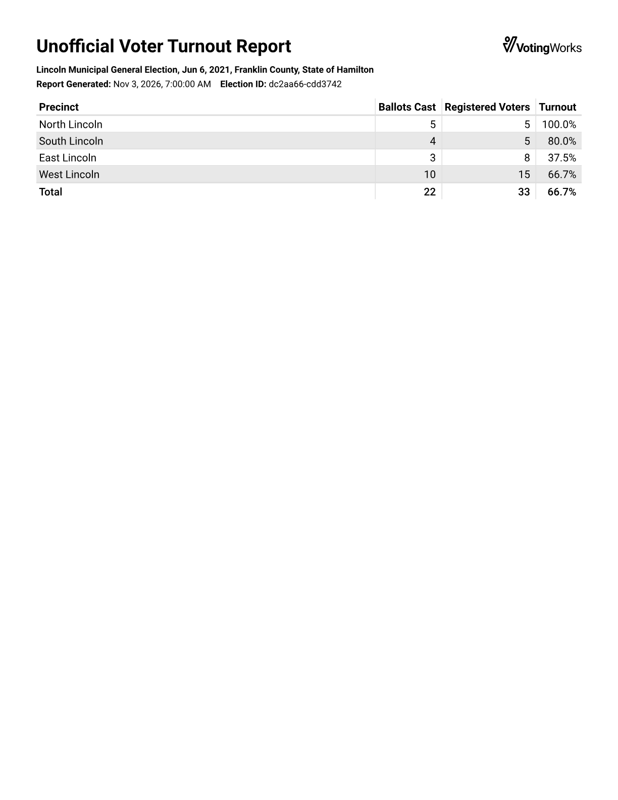

# Voter Turnout Report

The voter turnout report shows the turnout of the election by precinct. The turnout is calculated as the number of ballots divided by the number of registered voters per precinct.

<figure><figcaption></figcaption></figure>

The number of registered voters per precinct is pulled from the `registeredVoterCounts.json` in the election package. If the file is not included in the election package, the report is not available on VxAdmin.
